<!-- ═══════════════════════════  HEADER  ═══════════════════════════ -->


<div align="center">

<a href="https://git.io/typing-svg">
  
</a>

<br/>

<a href="https://www.linkedin.com/in/daniel-medrado-de-morais-79073b299/" target="_blank"></a>


</div>

---

## 🌸 About me

- 👋 Hi! I'm **Daniel**, a **Full-Stack Web Developer** who has a soft spot for the backend
- 🧩 I build APIs with **Node.js**, **NestJS** and **Express**, and make them pretty with **React**
- 🐳 I ship things in **Docker** containers

```js
const daniel = {
  role:        "Full-Stack Web Developer",
  home:        "São Paulo, SP 🇧🇷",
  backendLove: ["Node.js", "NestJS", "Express"],
  frontend:    ["React", "HTML", "CSS"],
  motto:       "make it work, then make it cute ✨",
};
```

---

## 🛠️ Tech I play with

<div align="center">

**💖 Main skills**<br/>
<a href="https://skillicons.dev"></a>

**🧰 Daily tools**<br/>
<a href="https://skillicons.dev"></a>

**🌱 Also know my way around**<br/>
<a href="https://skillicons.dev"></a>

</div>

---

## 📊 GitHub vibes

<div align="center">
  
  
</div>

<details>
<summary><b>🏆 Achievements unlocked</b> (click me!)</summary>
<br/>
<div align="center">
  
</div>
</details>

---

## 🐍 A snake is eating my commits

<div align="center">
  <picture>
    <source media="(prefers-color-scheme: dark)" srcset="./profile/snake-dark.svg" />
    <source media="(prefers-color-scheme: light)" srcset="./profile/snake-light.svg" />
    
  </picture>
</div>

---

<div align="center">

### 🤝 Let's build something together!

Got a project, an event, or just want to say hi?<br/>
My **LinkedIn** is always open 💌

<sub>Thanks for stopping by! (っ◔◡◔)っ ♥</sub>

</div>

<!-- ═══════════════════════════  FOOTER  ═══════════════════════════ -->

